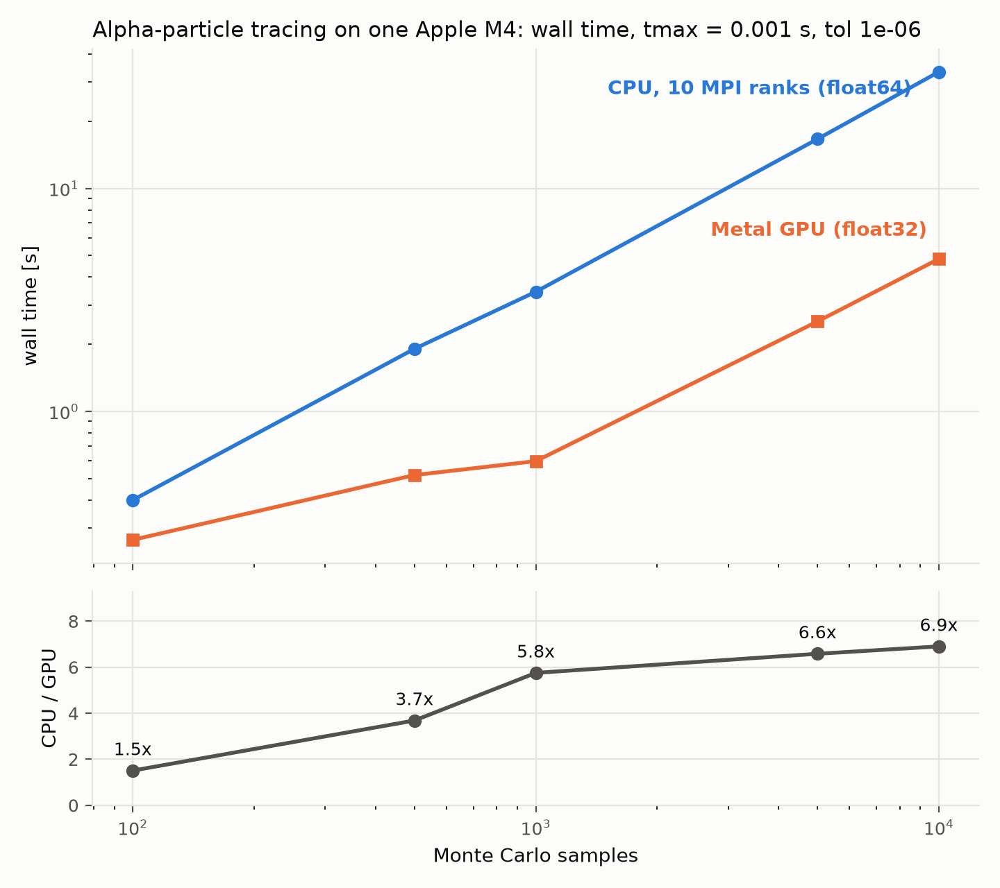
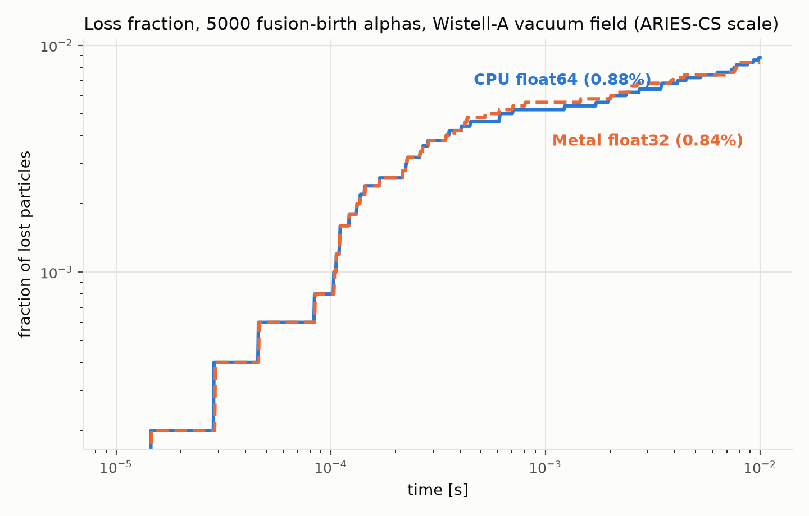

# CPU vs Metal GPU tracing benchmarks

Head-to-head comparison of FIRM3D's production MPI CPU tracer (float64)
against the new Metal GPU backend (float32) on Apple Silicon, on identical
physics. **Objective:** establish that the Metal backend is (a) substantially
faster than all CPU cores of the same machine combined and (b) statistically
indistinguishable in its physics output — the two conditions for it being
useful. The acceptance gate was a ≥3× speedup at production ensemble sizes.

## What is traced, and how

- **Markers:** fusion-birth alpha particles (3.5 MeV). Birth positions are
  sampled from a D–T reactivity profile peaked on axis
  (`n_D = 1 − s⁵`, `T = 11.5 (1 − s)` keV); parallel velocities are sampled
  uniformly in pitch. Sampling is seeded (seed 42), so both tracers
  integrate bit-identical initial conditions.
- **Field:** Wistell-A vacuum equilibrium scaled to ARIES-CS size
  (`examples/inputs/boozmn_aten_rescaled.nc`), tabulated on a 48³ grid with
  degree-3 interpolation, vacuum enforced — the `gc_vac` guiding-centre
  equations in Boozer coordinates, as in `examples/gpu_boozer_tracing`.
- **Integrator:** adaptive Dormand–Prince 5(4) with `abstol = reltol = 1e-6`
  on both backends. CPU: float64, boost odeint, MPI-parallel over particles
  (10 ranks = the M4's 10 physical cores). GPU: float32, the CATAPULT port
  to Metal, 8 particles per 32-thread SIMD-group.
- **Loss criterion:** a marker is lost when it crosses the `s = 1` flux
  surface; otherwise it survives to `tmax`. Trajectories are not stored
  (`forget_exact_path=True`), matching production loss-fraction runs.

Two workloads, defined once in the YAML config and run by both backends:

1. **Scaling leg** — ensembles of 100 to 10,000 markers traced for 1 ms,
   measuring how wall time grows with ensemble size.
2. **Validation leg** — 5,000 markers traced for 10 ms, comparing the full
   loss-fraction history, not just wall time.

## Results (Apple M4, 4P + 6E cores, 10-core GPU, 16 GB)

48³ cells, degree 3, tol 1e-6 (`bench_scaling_config_tol6.yaml`):

| Workload | CPU, 10 ranks | Metal GPU | Speedup | Lost, CPU / GPU |
| --- | --- | --- | --- | --- |
| 100 × 1 ms | 0.40 s | 0.26 s | 1.5× | 1 / 1 |
| 500 × 1 ms | 1.91 s | 0.52 s | 3.7× | 4 / 4 |
| 1,000 × 1 ms | 3.44 s | 0.60 s | 5.7× | 7 / 8 |
| 5,000 × 1 ms | 16.7 s | 2.53 s | 6.6× | 26 / 28 |
| 10,000 × 1 ms | 33.3 s | 4.83 s | 6.9× | 73 / 75 |
| 5,000 × 10 ms (validation) | 164.8 s | 25.4 s | 6.5× | 44 / 42 |

One-time setup before tracing: equilibrium build 4.6 s (CPU, 10 ranks) vs
0.9 s + 3.3 s CATAPULT table build (GPU, single process).

### Plots



*Scaling leg. Top: wall time vs ensemble size (log–log). The CPU curve is
near-linear throughout — MPI over particles saturates all 10 cores already
at small ensembles. The GPU curve is almost flat up to ~1,000 markers
because small ensembles under-fill the 10-core GPU; once it fills, the GPU
scales linearly too, at a ~7× lower slope. Bottom: the resulting speedup,
growing from 1.5× at 100 markers to 6.9× at 10,000 — the GPU advantage is
largest exactly where the physics needs it, at large Monte Carlo ensembles.*



*Validation leg: cumulative loss fraction of 5,000 alphas over 10 ms
(log–log). The float32 GPU curve tracks the float64 CPU reference across
the full trace — same prompt-loss onset, same shape — ending at 0.84% vs
0.88% (42 vs 44 lost markers). A ±1σ Poisson band on 44 counts is ±0.13
percentage points, so the two endpoints are statistically identical.*

## Reproducibility and noise

- **Loss statistics are deterministic.** The seed fixes the markers, and
  each marker integrates independently (no cross-particle coupling, no
  order-dependent reductions on either backend), so re-running a benchmark
  reproduces the same loss counts exactly — on the CPU side independently
  of the number of ranks. Re-runs during this work never changed a count.
- **Wall times carry a few percent of noise**, dominated by thermal state:
  under sustained load the M4 settles ~8% slower than a cold start (the
  validation leg measures 25.4 s cold, ~27.5 s hot). Compare timings only
  back-to-back under the same thermal conditions, and expect the table
  above (measured cold) to read slightly optimistic mid-session.
- **The meaningful uncertainty is statistical, not run-to-run:** with ~44
  losses the Poisson error is ±15%. A different seed would move both
  backends' loss fractions together by about that much; conclusions should
  rest on the agreement between backends, not on the absolute 0.88%.

## Files

| File | Produces / holds |
| --- | --- |
| `bench_scaling_config_tol6.yaml` | tol 1e-6 run, the headline numbers |
| `bench_scaling_config.yaml` | tol 1e-8 run (see Numerical notes) |
| `bench_common.py` | field build, sampling, survivor classification |
| `bench_metal_gpu.py` | GPU benchmark (single process) |
| `bench_cpu_scaling.py` | CPU benchmark (MPI over particles) |
| `make_plots.py` | figures from the two result files |

Each config's results live in `results/` (`*_tol6.json` for the tol 1e-6
run, `cpu_results.json` / `metal_results.json` for tol 1e-8).

## Reproducing

From this directory:

```sh
python bench_metal_gpu.py bench_scaling_config_tol6.yaml \
    results/metal_results_tol6.json
mpiexec -n 10 python -m mpi4py bench_cpu_scaling.py \
    bench_scaling_config_tol6.yaml results/cpu_results_tol6.json
python make_plots.py results/cpu_results_tol6.json \
    results/metal_results_tol6.json plots
```

Set `-n` to the machine's physical core count. Always launch the MPI script
through `python -m mpi4py`: it converts an uncaught exception on one rank into
`MPI_Abort`, where a plain script would leave the other ranks deadlocked in
their next collective.

## Numerical notes

- **Use tol 1e-6 for single precision** (the setting of
  `examples/gpu_boozer_tracing`). A tolerance of 1e-8 sits below float32's
  roundoff floor (machine epsilon ≈ 1.2e-7), so the step controller chases
  rounding noise: the tol 1e-8 results in `results/` show the same physics but
  ~2.3× longer GPU wall times.
- **Survivor classification needs a float32-aware margin.** The GPU integrates
  time in float32 and stops at the first step boundary at or after tmax, so a
  survivor can finish exactly on `float32(tmax)` — about 2.2e-9 *below* the
  float64 tmax at tmax = 1e-2. Strict float64 comparisons (including the 1e-15
  margin in `compute_loss_fraction`) then count it as lost;
  `bench_common.snap_survivor_times_inplace` corrects for this before any loss
  accounting.
- `comm` is passed to `BoozerRadialInterpolant` only, never also to
  `InterpolatedBoozerField`: the former parallelises over Fourier modes with
  identically sized collectives on every rank, while point-parallelising the
  latter on top of it nests mismatched Allreduces (`MPI_ERR_TRUNCATE`).
