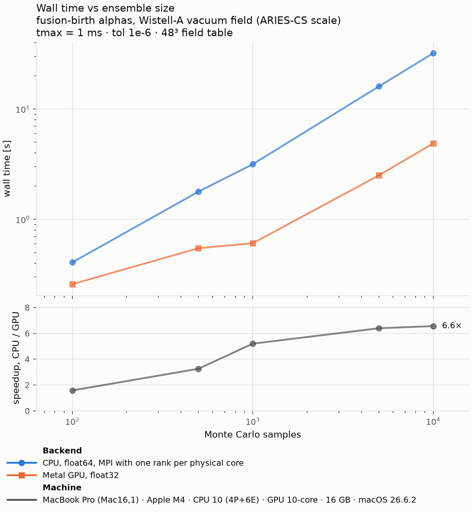
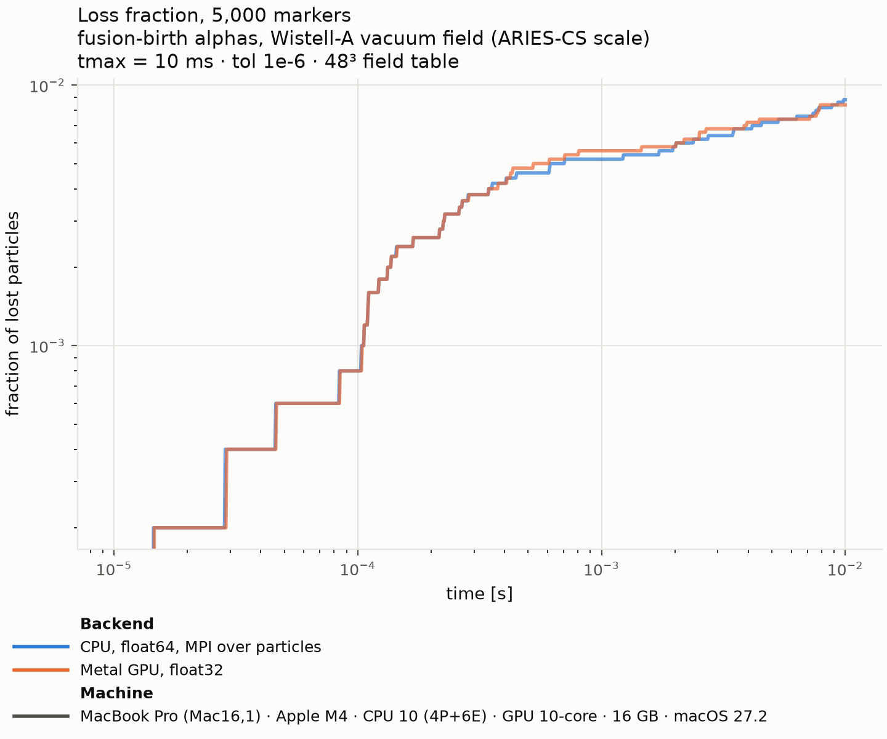
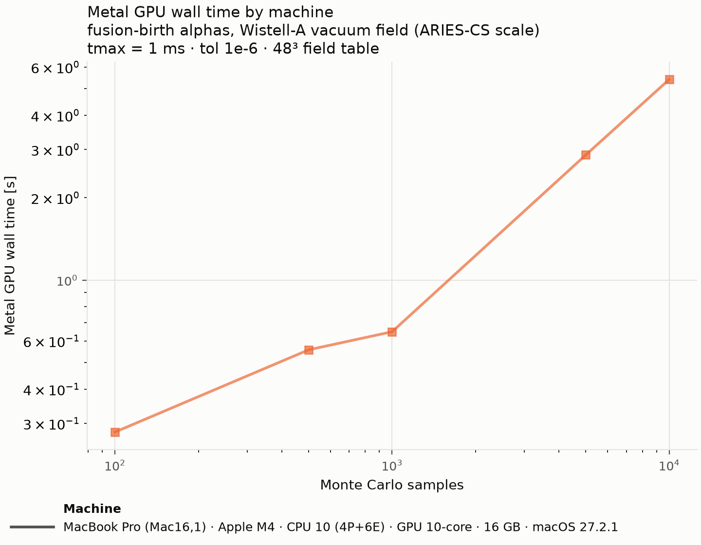

# CPU vs Metal GPU tracing benchmarks

Head-to-head comparison of FIRM3D's production MPI CPU tracer (float64)
against the new Metal GPU backend (float32) on Apple-Silicon Macs, on
identical physics. **Objective:** establish that the Metal backend is
(a) substantially faster than all CPU cores of the same machine combined
and (b) statistically indistinguishable in its physics output — the two
conditions for it being useful — and measure how both scale across the
M-series line-up. The acceptance gate was a ≥3× speedup at production
ensemble sizes on a base M4.

## Benchmark your Mac

Three steps; contributions from any M-series Mac are welcome.

**1. Install** (about 3 minutes; asks before installing anything with
Homebrew):

```sh
git clone https://github.com/neildhir/firm3d_metal.git
cd firm3d_metal
bash install/macOS/install_firm3d_metal.sh
```

**2. Run** (about 6 minutes on a base M4). Plug in the power adapter,
quit heavy apps, and leave the machine alone until it finishes:

```sh
cd benchmarks
../.venv/bin/python run_benchmark.py alpha-loss-wistell-a.yaml \
    --tag <your-github-handle>
```

It refuses to run on battery, in Low Power Mode, on a stale build, or
with uncommitted changes, and ends by printing your numbers and either
"Sanity check passed" or why not. A failed run must not be submitted:
report it instead.

**3. Submit** — see [Submitting a run](#submitting-a-run).

## What is traced, and how

- **Markers:** fusion-birth alpha particles (3.5 MeV). Birth positions are
  sampled from a D–T reactivity profile peaked on axis
  (`n_D = 1 − s⁵`, `T = 11.5 (1 − s)` keV); parallel velocities are sampled
  uniformly in pitch. Sampling is seeded (seed 42), so both tracers
  integrate bit-identical initial conditions.
- **Field:** Wistell-A vacuum equilibrium scaled to ARIES-CS size
  (`examples/inputs/boozmn_aten_rescaled.nc`), tabulated on a 48³ grid with
  degree-3 interpolation, vacuum enforced — the `gc_vac` guiding-centre
  equations in Boozer coordinates, as in `examples/gpu_boozer_tracing`.
- **Integrator:** adaptive Dormand–Prince 5(4) with `abstol = reltol = 1e-6`
  on both backends. CPU: float64, boost odeint, MPI-parallel over
  particles, one rank per physical core. GPU: float32, the CATAPULT port
  to Metal, 8 particles per 32-thread SIMD-group.
- **Loss criterion:** a marker is lost when it crosses the `s = 1` flux
  surface; otherwise it survives to `tmax`. Trajectories are not stored
  (`forget_exact_path=True`), matching production loss-fraction runs.

Two workloads, defined once in `alpha-loss-wistell-a.yaml` and run by
both backends:

1. **Scaling leg** — ensembles of 100 to 10,000 markers traced for 1 ms,
   measuring how wall time grows with ensemble size.
2. **Validation leg** — 5,000 markers traced for 10 ms, comparing the full
   loss-fraction history, not just wall time.

Each run goes CPU leg → 60 s cool-down → GPU leg, and records the
machine's exact hardware (model identifier, chip, P/E core split, GPU
cores, memory, macOS), the power, thermal state, and load average around
each leg, and fingerprints of the config, equilibrium, and Metal sources.

## Results

<!-- markdownlint-disable MD013 -->
| Machine | CPU ranks | 10,000 × 1 ms: CPU / GPU | Speedup | 5,000 × 10 ms: CPU / GPU | Speedup | Lost, CPU / GPU |
| --- | --- | --- | --- | --- | --- | --- |
| MacBook Pro (Mac16,1) · Apple M4 · CPU 10 (4P+6E) · GPU 10-core · 16 GB · macOS 26.6.2 | 10 | 32.0 s / 4.9 s | 6.6× | 176.6 s / 26.2 s | 6.7× | 44 / 42 |
<!-- markdownlint-enable MD013 -->

The machine label reads: model (identifier) · chip · CPU cores
(performance + efficiency) · GPU cores · memory · macOS.



*Scaling leg. Top: wall time vs ensemble size (log–log). The CPU curve is
near-linear throughout — MPI over particles saturates all cores already at
small ensembles. The GPU curve is almost flat up to ~1,000 markers because
small ensembles under-fill the GPU; once it fills, the GPU scales linearly
too, at a 6–7× lower slope on a base M4. Bottom: the resulting speedup,
labelled at each machine's largest ensemble — the GPU advantage is largest
exactly where the physics needs it, at large Monte Carlo ensembles.*



*Validation leg: cumulative loss fraction of 5,000 alphas over 10 ms
(log–log). On the M4 the float32 GPU curve tracks the float64 CPU
reference across the full trace — same prompt-loss onset, same shape —
ending at 0.84% vs 0.88% (42 vs 44 lost), well inside a ±1σ Poisson band
of ±0.13 percentage points. Marker by marker, 8 of 5,000 end differently
(5 lost only on the CPU, 3 only on the GPU): chaotic divergence of orbits
near the loss boundary, symmetric between backends rather than a bias.*



*GPU wall time alone, one line per machine: the direct hardware
comparison, free of each machine's CPU baseline.*

**Reading the plots:** colour is the backend (blue CPU, orange GPU), line
style the machine (solid, dashed, dotted, dash-dot, in order of each
machine's first run). Lines are drawn semi-transparent, so curves that
coincide across machines show through. Each machine is plotted from its
latest run that passed the sanity check.

## Submitting a run

Results reach this repository by pull request, one run folder per PR.

1. Fork `neildhir/firm3d_metal` on GitHub, then add your fork as a remote:
   `git remote add fork https://github.com/<you>/firm3d_metal.git`.
2. Commit **only your run folder**, on a branch:

   ```sh
   git switch -c results/<you>
   git add benchmarks/results/alpha-loss-wistell-a/<your-run-folder>
   git commit -m "chore: add <chip> benchmark run"
   git push fork results/<you>
   ```

3. Open a pull request into **`neildhir/firm3d_metal`**, branch `master`.
   Check the base repository before submitting: this fork is itself a
   fork of `ColumbiaStellaratorTheory/firm3d`, and GitHub's pull-request
   form can pre-select that upstream repository instead, which would
   send the unfinished Metal work there. Either open this pre-filled
   link, with your handle in place of `<you>`:

   ```text
   https://github.com/neildhir/firm3d_metal/compare/master...<you>:results/<you>
   ```

   or use the GitHub CLI, which names the target explicitly:

   ```sh
   gh pr create --repo neildhir/firm3d_metal --base master \
       --head <you>:results/<you>
   ```

Rules that keep pull requests conflict-free:

- **Never commit `plots/` or this README.** The maintainer regenerates
  both after merging (`python make_plots.py`, which also prints the
  results table), so contributions never collide.
- Never edit another run's folder, and delete any `*.incomplete` folder
  (a crashed run) rather than submitting it.
- Re-running on the same machine (after an update, say) is welcome: the
  plots show each machine's latest run, the older ones stay on record.

No GitHub account? Zip the run folder and send it to the maintainer.

## Reproducibility and noise

- **Loss statistics are deterministic.** The seed fixes the markers, and
  each marker integrates independently (no cross-particle coupling, no
  order-dependent reductions on either backend), so re-running a benchmark
  reproduces the same results bit for bit on both backends (checked on
  the M4's final states) — on the CPU side independently of the number
  of ranks.
- **Wall times are the noisy part, and macOS's thermal state does not
  see it.** Back-to-back runs on the M4 agreed to ~1% on the 3-minute
  validation leg, but the short scaling legs swung by up to 15% (CPU,
  10,000 × 1 ms: 37.7 s, then 32.0 s seven minutes later), and the CPU
  validation leg ran ~7% slower than on another day (176 s vs 165 s),
  all with the thermal state reading "nominal". Each run therefore also
  records the load average, and the run order is fixed (CPU, 60 s
  cool-down, GPU). **Treat speedup differences between machines under
  ~15% as noise** until each machine has repeat runs. Fanless machines
  (MacBook Air) also throttle under sustained load; that is a property
  of the machine, not noise, which is why the chassis is in the label.
- **The meaningful uncertainty is statistical, not run-to-run:** with ~44
  losses the Poisson error is ±15%. A different seed would move both
  backends' loss fractions together by about that much; conclusions should
  rest on the agreement between backends, not on the absolute loss
  fraction.
- **The sanity check catches broken installs, not subtle physics.** It
  passes any GPU loss count within 3σ of the CPU's (about 20–77 for the
  M4's 44 losses). Claims that Metal gives the same physics on every chip
  should rest on the loss curves and the per-marker final states, not on
  the check passing.
- **Comparability is enforced.** `make_plots.py` refuses to plot runs whose
  config or equilibrium differ, and warns when the Metal sources differ.
  `run_benchmark.py` refuses to run with any `FIRM3D_METAL_*` debug
  variable set (`FIRM3D_METAL_FAST_MATH` would shift trajectories at
  roundoff level). To change the workload, copy the config to a new
  benchmark name: its runs and plots then live under that name.

## Files

| File | Holds / does |
| --- | --- |
| `alpha-loss-wistell-a.yaml` | the benchmark: workloads, field, tolerance |
| `run_benchmark.py` | the one command: checks, both legs, filing |
| `machine.py` | hardware fingerprint and run conditions |
| `bench_cpu_scaling.py` | CPU leg (MPI over particles) |
| `bench_metal_gpu.py` | GPU leg (single process) |
| `bench_common.py` | field build, sampling, loss counting, output |
| `make_plots.py` | figures and results table from every run |
| `results/<benchmark>/` | one folder per run (see below) |
| `results/archive/` | first M4 runs, pre-fingerprint; not plotted |

A run folder holds `run.json` (machine, conditions, fingerprints, sanity
check), `cpu.json` and `metal.json` (timings, loss counts, loss-fraction
curves), and the validation ensemble's final states in
`cpu_final_states.npz` and `metal_final_states.npz`.

To run a leg by hand (for profiling, say), call its script directly, from
this directory:

```sh
../.venv/bin/python bench_metal_gpu.py alpha-loss-wistell-a.yaml metal.json
mpiexec -n <physical cores> ../.venv/bin/python -m mpi4py \
    bench_cpu_scaling.py alpha-loss-wistell-a.yaml cpu.json
```

Always launch the MPI script through `python -m mpi4py`: it converts an
uncaught exception on one rank into `MPI_Abort`, where a plain script would
leave the other ranks deadlocked in their next collective.

## Numerical notes

- **Use tol 1e-6 for single precision** (the setting of
  `examples/gpu_boozer_tracing`). A tolerance of 1e-8 sits below float32's
  roundoff floor (machine epsilon ≈ 1.2e-7), so the step controller chases
  rounding noise: the archived tol 1e-8 run
  (`results/archive/2026-10-27_m4/`) shows the same physics but ~2.3×
  longer GPU wall times.
- **Survivor classification needs a float32-aware margin.** The GPU
  integrates time in float32 and stops at the first step boundary at or
  after tmax, so a survivor can finish exactly on `float32(tmax)` — about
  2.2e-9 *below* the float64 tmax at tmax = 1e-2. The strict 1e-15 margin
  in `compute_loss_fraction` then counts it as lost;
  `bench_common.snap_survivor_times_inplace` corrects for this before any
  loss accounting. The fix is proposed upstream in
  ColumbiaStellaratorTheory/firm3d#101.
- `comm` is passed to `BoozerRadialInterpolant` only, never also to
  `InterpolatedBoozerField`: the former parallelises over Fourier modes with
  identically sized collectives on every rank, while point-parallelising the
  latter on top of it nests mismatched Allreduces (`MPI_ERR_TRUNCATE`).
