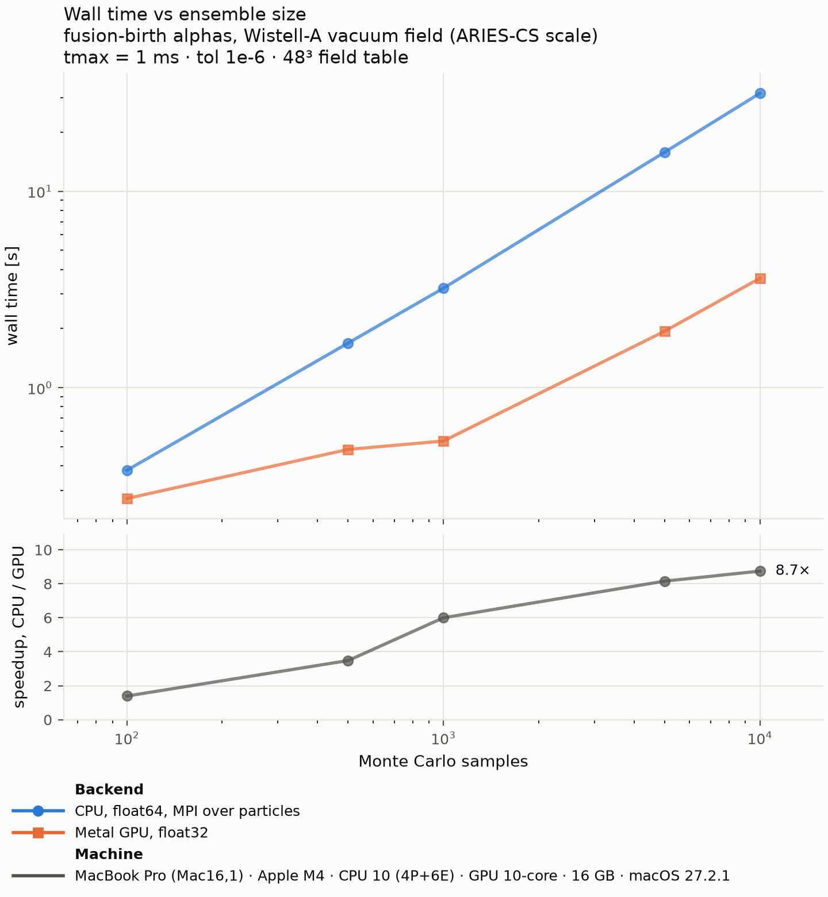
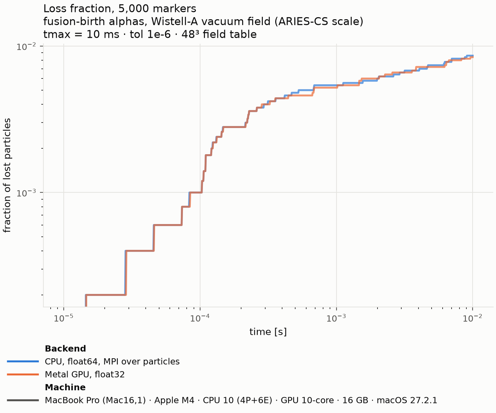
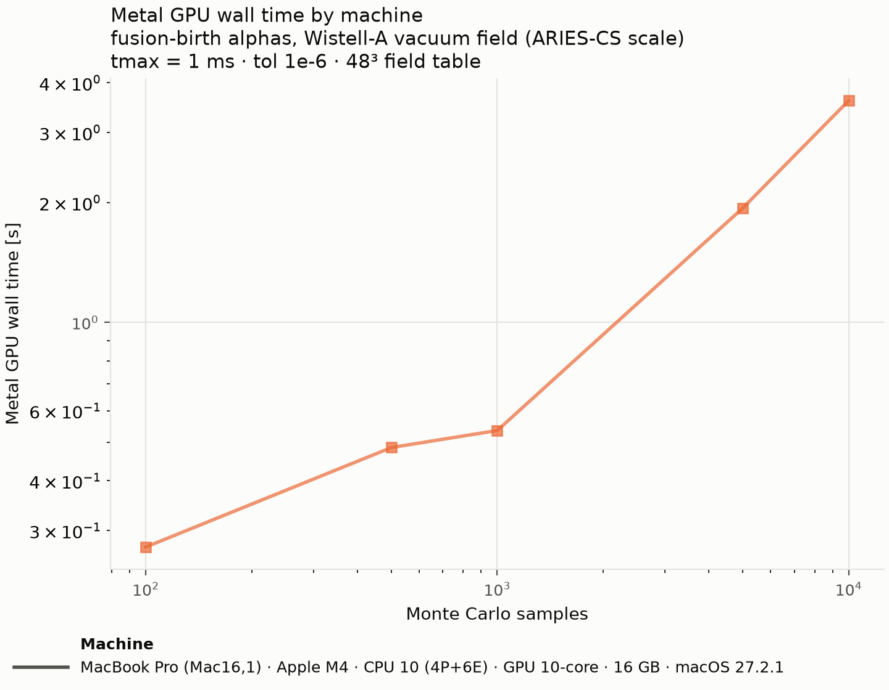

# Benchmark: alpha losses in Wistell-A (v2)

[← All benchmarks](README.md)

The workload of [alpha losses in Wistell-A](alpha-loss-wistell-a.md), with
the traced alpha particle pinned in `alpha-loss-wistell-a-v2.yaml` rather
than taken from firm3d. Upstream firm3d changed the alpha's mass on
2026-10-31, from two proton plus two neutron masses to the measured alpha
mass, 0.76% lighter, which shifts every orbit; this benchmark traces the
new mass. The question, set-up, method and numerical notes are those on the
first benchmark's page.

## Results

<!-- make_plots:summary -->
<!-- /make_plots:summary -->

*Scaling leg: wall time against ensemble size (log–log), and the speedup.*

*Validation leg: cumulative loss fraction of 5,000 alphas over 10 ms.*

*GPU wall time alone, one line per machine.*

## Physics agreement, marker by marker

<!-- make_plots:physics -->
<!-- /make_plots:physics -->

The comparisons are those described on the
[first benchmark's page](alpha-loss-wistell-a.md#physics-agreement-marker-by-marker).
