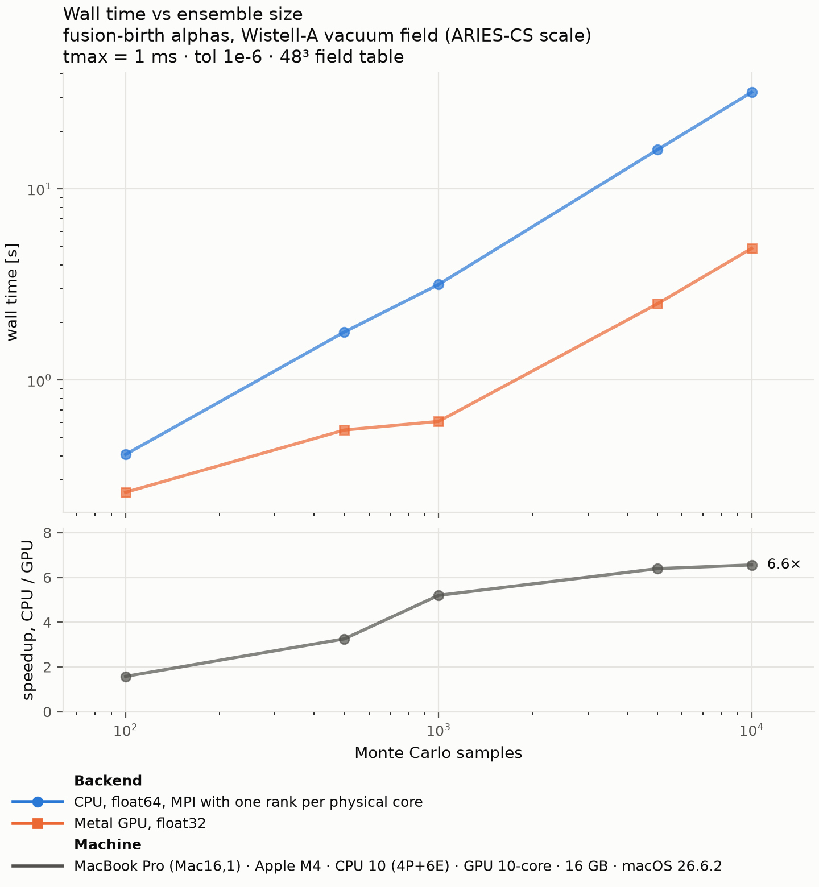
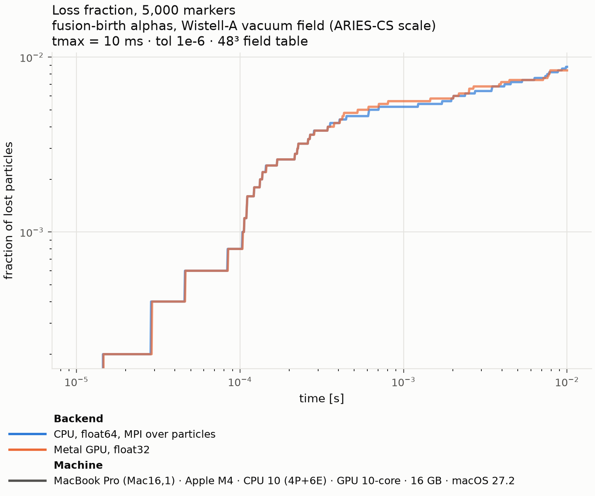
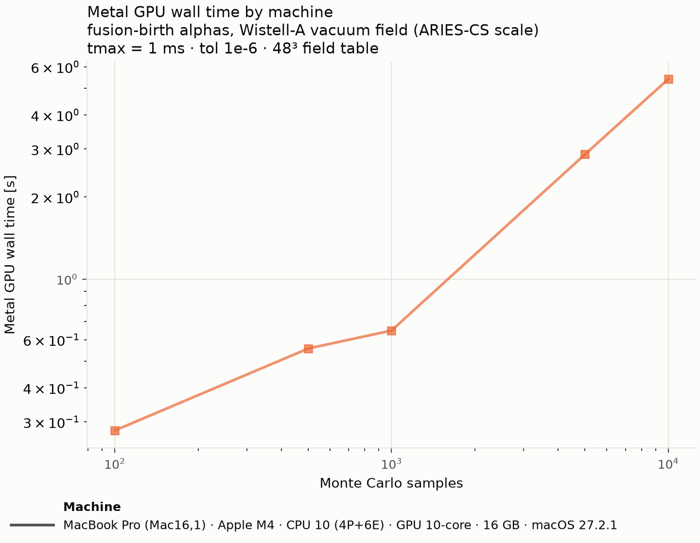

# Benchmark: alpha losses in Wistell-A

[← All benchmarks](README.md)

**Question:** how much faster is the Metal GPU than all CPU cores of the
same Mac at production ensemble sizes, and does float32 reproduce the
float64 loss statistics? The original acceptance gate was a ≥3× speedup at
production ensemble sizes on a base M4.

## What is traced, and how

- **Markers:** fusion-birth alpha particles (3.5 MeV). Birth positions are
  sampled from a D–T reactivity profile peaked on axis
  (`n_D = 1 − s⁵`, `T = 11.5 (1 − s)` keV); parallel velocities are sampled
  uniformly in pitch. Sampling is seeded (seed 42), so both tracers
  integrate bit-identical initial conditions.
- **Field:** Wistell-A vacuum equilibrium scaled to ARIES-CS size
  (`examples/inputs/boozmn_aten_rescaled.nc`), tabulated on a 48³ grid with
  degree-3 interpolation, vacuum enforced — the `gc_vac` guiding-centre
  equations in Boozer coordinates, as in `examples/gpu_boozer_tracing`.
- **Integrator:** adaptive Dormand–Prince 5(4) with `abstol = reltol = 1e-6`
  on both backends. CPU: float64, boost odeint, MPI-parallel over
  particles, one rank per physical core. GPU: float32, the CATAPULT port
  to Metal, 8 particles per 32-thread SIMD-group.
- **Loss criterion:** a marker is lost when it crosses the `s = 1` flux
  surface; otherwise it survives to `tmax`. Trajectories are not stored
  (`forget_exact_path=True`), matching production loss-fraction runs.

Two workloads, defined once in `alpha-loss-wistell-a.yaml`:

1. **Scaling leg** — ensembles of 100 to 10,000 markers traced for 1 ms,
   measuring how wall time grows with ensemble size.
2. **Validation leg** — 5,000 markers traced for 10 ms, comparing the full
   loss-fraction history, not just wall time.

## Results

<!-- make_plots:summary -->
<!-- markdownlint-disable MD013 -->
| Machine | CPU ranks | 10,000 × 1 ms: CPU / GPU | Speedup | 5,000 × 10 ms: CPU / GPU | Speedup | Lost, CPU / GPU |
| --- | --- | --- | --- | --- | --- | --- |
| MacBook Pro (Mac16,1) · Apple M4 · CPU 10 (4P+6E) · GPU 10-core · 16 GB · macOS 26.6.2 | 10 | 32.0 s / 4.9 s | 6.6× | 176.6 s / 26.2 s | 6.7× | 44 / 42 |
<!-- markdownlint-enable MD013 -->
<!-- /make_plots:summary -->

*Scaling leg. Top: wall time vs ensemble size (log–log). The CPU curve is
near-linear throughout — MPI over particles saturates all cores already at
small ensembles. The GPU curve is almost flat up to ~1,000 markers because
small ensembles under-fill the GPU; once it fills, the GPU scales linearly
too, at a 6–7× lower slope on a base M4. Bottom: the resulting speedup,
labelled at each machine's largest ensemble — the GPU advantage is largest
exactly where the physics needs it, at large Monte Carlo ensembles.*

*Validation leg: cumulative loss fraction of 5,000 alphas over 10 ms
(log–log). On the M4 the float32 GPU curve tracks the float64 CPU
reference across the full trace — same prompt-loss onset, same shape —
ending at 0.84% vs 0.88% (42 vs 44 lost), well inside a ±1σ Poisson band
of ±0.13 percentage points.*

*GPU wall time alone, one line per machine: the direct hardware
comparison, free of each machine's CPU baseline.*

## Physics agreement, marker by marker

<!-- make_plots:physics -->
<!-- markdownlint-disable MD013 -->
| Machine | CPU vs GPU | Reference GPU vs GPU | Reference CPU vs CPU | Check |
| --- | --- | --- | --- | --- |
| MacBook Pro (Mac16,1) · Apple M4 · CPU 10 (4P+6E) · GPU 10-core · 16 GB · macOS 26.6.2 | 8 fates differ (5 / 3), p 0.73; losses -5% (95% CI -15% to +9%); loss time ×1.001, p 0.39 | reference | reference | pass |
<!-- markdownlint-enable MD013 -->
<!-- /make_plots:physics -->

Every trace follows the same seeded markers, so `make_plots.py` compares
them one by one (`physics_check.py`): each machine's CPU against its GPU,
and each machine's traces against the first machine's. Per comparison:

- **fates differ (a / b):** markers lost in one trace only — chaotic
  orbits near the loss boundary, where roundoff decides. McNemar's exact
  test asks whether they split evenly, i.e. whether one trace
  systematically loses more.
- **losses ±x% (95% CI):** the relative change in the number of markers
  lost, with an exact interval. On the M4 the GPU loses 5% fewer than the
  CPU, and the data allow anything from 15% fewer to 9% more.
- **loss time ×r:** the median loss-time ratio of markers lost in both,
  with a Wilcoxon signed-rank test for one trace losing them
  systematically sooner.

A machine fails at a 1% family-wise false-alarm rate, and is then flagged
in the plot legends too. Read **pass** as "no large systematic
difference": with ~44 of 5,000 markers lost, a GPU must lose about 35–40%
more than the CPU before the check can tell. The confidence interval is
the claim the data support; narrowing it to a few percent needs many more
lost markers, i.e. a larger ensemble or a longer tmax.

The statistical uncertainty dwarfs the run-to-run one: with ~44 losses the
Poisson error is ±15%, so a different seed would move both backends' loss
fractions together by about that much. Conclusions rest on the agreement
between backends, not on the absolute loss fraction.

## Numerical notes

- **Use tol 1e-6 for single precision** (the setting of
  `examples/gpu_boozer_tracing`). A tolerance of 1e-8 sits below float32's
  roundoff floor (machine epsilon ≈ 1.2e-7), so the step controller chases
  rounding noise: the archived tol 1e-8 run
  (`results/archive/2026-10-27_m4/`) shows the same physics but ~2.3×
  longer GPU wall times. The [conservation benchmark](conservation-qh.md)
  measures the same limit against a ground truth.
- **Survivor classification needs a float32-aware margin.** The GPU
  integrates time in float32 and stops at the first step boundary at or
  after tmax, so a survivor can finish exactly on `float32(tmax)` — about
  2.2e-9 *below* the float64 tmax at tmax = 1e-2. The strict 1e-15 margin
  in `compute_loss_fraction` then counts it as lost;
  `bench_common.snap_survivor_times_inplace` corrects for this before any
  loss accounting. The fix is proposed upstream in
  ColumbiaStellaratorTheory/firm3d#101.
- `comm` is passed to `BoozerRadialInterpolant` only, never also to
  `InterpolatedBoozerField`: the former parallelises over Fourier modes with
  identically sized collectives on every rank, while point-parallelising the
  latter on top of it nests mismatched Allreduces (`MPI_ERR_TRUNCATE`).
