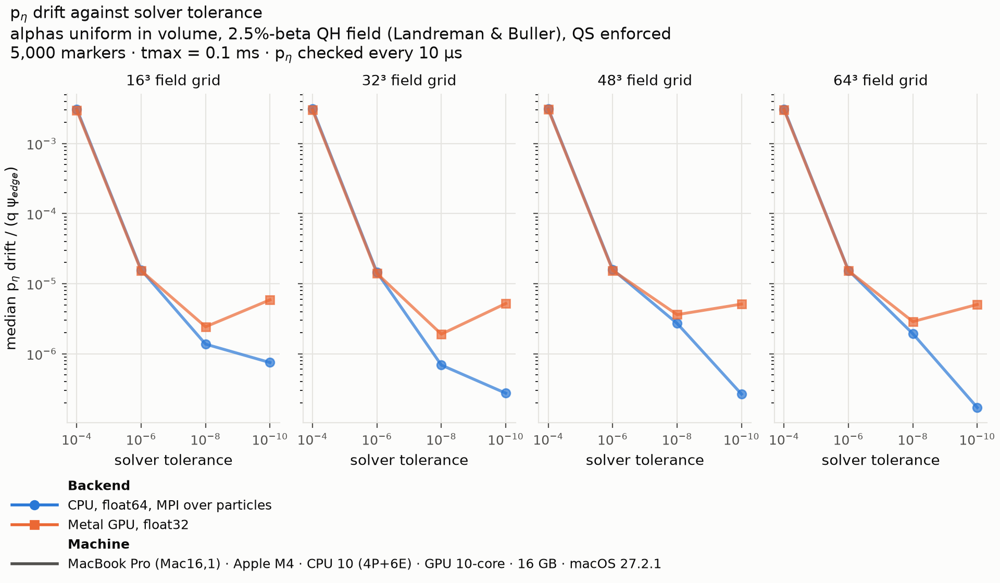
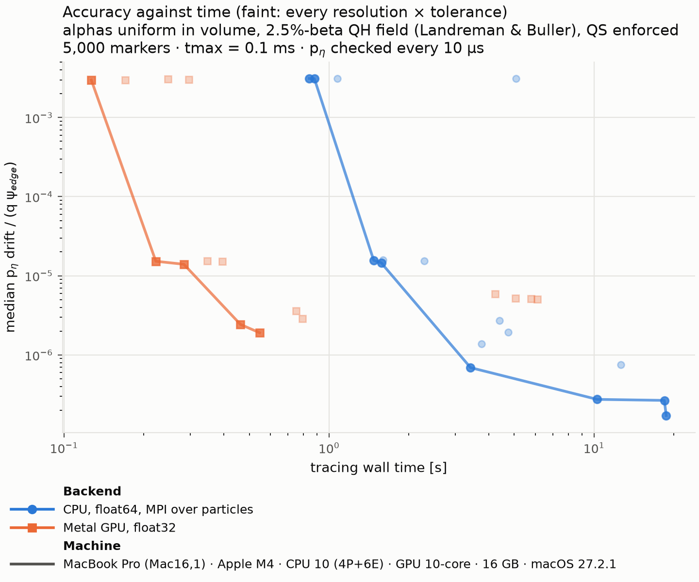

# Benchmark: p_η conservation in a quasi-helical field (v2)

[← All benchmarks](README.md)

The workload of [p_η conservation in a quasi-helical field](conservation-qh.md),
with the traced alpha particle pinned in `conservation-qh-v2.yaml` rather
than taken from firm3d. Upstream firm3d changed the alpha's mass on
2026-10-31, from two proton plus two neutron masses to the measured alpha
mass, 0.76% lighter, which shifts every orbit; this benchmark traces the
new mass. The question, the ground truth, the set-up and the notes are
those on the first benchmark's page.

## Results

<!-- make_plots:summary -->
<!-- /make_plots:summary -->

*Median p_η drift against solver tolerance, one panel per field grid.*

*Accuracy against tracing time: each backend's best accuracy within a given
time.*

## Agreement across machines

<!-- make_plots:agreement -->
<!-- /make_plots:agreement -->

The comparison is the one described on the
[first benchmark's page](conservation-qh.md#agreement-across-machines).
