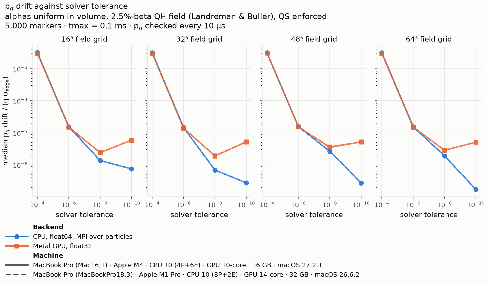
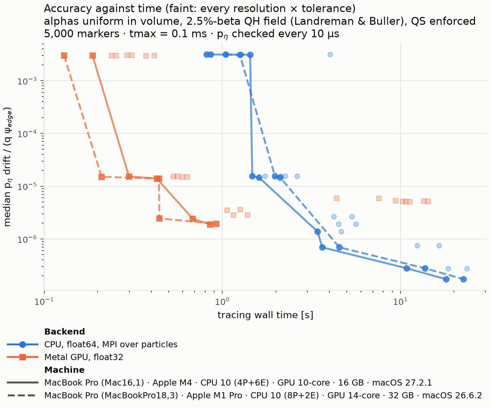

# Benchmark: p_η conservation in a quasi-helical field

[← All benchmarks](README.md)

**Question:** measured against a known answer rather than against the CPU,
how accurate is float32 tracing on the Metal GPU, and at what cost
compared with float64 on all CPU cores?

## Why this test has a ground truth

In a field whose strength is exactly quasi-symmetric, the guiding-centre
equations conserve the canonical momentum conjugate to the symmetry
direction, p_η (`firm3d.trajectory_helpers.compute_peta`). Any change of
p_η along a trace is therefore numerical error, from three sources: the
field's representation on a grid (resolution), the integrator
(tolerance), and the arithmetic (float64 or float32). The benchmark scans
the first two to expose the third.

## What is traced, and how

- **Field:** the 2.5%-beta quasi-helical equilibrium of Landreman & Buller
  (`examples/inputs/boozmn_beta2.5_QH.nc`), with quasi-symmetry enforced
  (helicity M = 1, N = −4) and the Boozer K dropped, as in upstream's
  `examples/resolution_scan`: the finite-beta no-K guiding-centre
  equations. Dropping K matters: with a symmetry-filtered K kept, p_η
  drifts by 1.3e-5 at both 32³ and 64³, so the drift would measure the
  model rather than the numerics.
- **Markers:** 5,000 alphas (3.5 MeV) uniform in volume, parallel
  velocities uniform in pitch, seed 42, identical on both backends. About
  290 cross `s = 1` within the trace; their drift is measured up to the
  crossing.
- **Grid:** field resolutions 16³ to 64³ × solver tolerances 1e-4 to 1e-10
  (`abstol = reltol`); each of the 16 cells traces every marker for 0.1 ms.
  CPU: the field's 3-D interpolant at that resolution, float64, MPI over
  particles. GPU: the CATAPULT table at that resolution, built from the
  exact field as upstream's GPU example does, float32.
- **Metric:** per marker, the largest change of p_η over the trace,
  sampled every 10 µs and evaluated on the exact field (one yardstick for
  both backends), divided by q·|ψ_edge|, the natural scale of p_η. Tables
  and figures quote the median over markers; the 90th and 99th
  percentiles and the maximum are in each run's JSON.

**Not in upstream's units.** Upstream's `resolution_scan` divides each of
10 markers' drift by its own initial p_η and reports the worst marker
(about 1e-8 at 64³, tol 1e-10). That ratio blows up for markers starting
near p_η = 0, and with 5,000 markers some always do, giving "errors" of
order 1 on both backends; hence the fixed scale here. Each run stores the
markers' initial p_η, so upstream's metric can still be computed from the
data.

## Results

<!-- make_plots:summary -->
<!-- markdownlint-disable MD013 -->
| Machine | CPU ranks | Best median drift, CPU | Best median drift, GPU | Tracing to the GPU's best, CPU / GPU | Speedup | With field builds |
| --- | --- | --- | --- | --- | --- | --- |
| MacBook Pro (Mac16,1) · Apple M4 · CPU 10 (4P+6E) · GPU 10-core · 16 GB · macOS 27.2.1 | 10 | 1.7e-07 (64³, tol 1e-10) | 1.9e-06 (32³, tol 1e-8) | 3.43 s (16³, tol 1e-8) / 0.85 s (32³, tol 1e-8) | 4.0× | 0.9× |
| MacBook Pro (MacBookPro18,3) · Apple M1 Pro · CPU 10 (8P+2E) · GPU 14-core · 32 GB · macOS 26.6.2 | 10 | 1.7e-07 (64³, tol 1e-10) | 1.9e-06 (32³, tol 1e-8) | 4.54 s (32³, tol 1e-8) / 0.92 s (32³, tol 1e-8) | 4.9× | 0.9× |
<!-- markdownlint-enable MD013 -->
<!-- /make_plots:summary -->

On the M4:

- **Where float32 resolves the tolerance (1e-4, 1e-6), CPU and GPU
  conserve p_η identically,** within 5% on every grid, the GPU tracing
  2–5× faster.
- **float32's floor is a median drift of about 2e-6,** reached at tol
  1e-8. The CPU goes on to 1.7e-7 (64³, tol 1e-10), about 10× better.
- **Tightening the GPU's tolerance past 1e-8 backfires:** at 1e-10 the
  drift grows to about 5e-6 and tracing takes 7–10× longer, as the solver
  takes steps too small for float32 to represent and accumulates rounding
  error instead.

**Practical rule for single precision:** run the GPU at a tolerance of
1e-6 to 1e-8. At 1e-6 it matches float64 at the same tolerance; at 1e-8 it
reaches the float32 floor; anything tighter costs both time and accuracy.
For conservation better than about 2e-6, use the CPU.

*Median p_η drift against solver tolerance, one panel per field grid. CPU
(blue) and GPU (orange) coincide down to tol 1e-6; at 1e-8 the GPU
flattens at its floor, and at 1e-10 it rises again. The CPU keeps
improving, levelling off only where the grid limits it (16³).*

*Accuracy against tracing time. Faint points: all 16 cells of each
backend; lines: each backend's front, the best accuracy reached within a
given time. The GPU's front lies left of the CPU's (the same accuracy
sooner) down to its floor near 2e-6; below that only the CPU goes.*

### Time, and the field builds

The speedups count tracing only. Before tracing, each backend builds its
field representation once per resolution: the CPU's 3-D interpolant
(MPI-parallel; 1.3 s at 32³ and 8 s at 64³ on the M4) and the GPU's
CATAPULT table (one process, sampling the field at (3N + 1)³ points;
3.6 s at 32³ and 66 s at 64³). A build serves every tolerance and every
later trace at that resolution, so in production it is paid once. This
benchmark's 0.1 ms traces are the worst case for it: the "with field
builds" column charges a whole build to one trace, which brings the two
backends about level at the GPU's best cell. Parallelising the table
build would remove most of that cost.

CPU tracing times are noisier than the drifts: at 64³ two back-to-back M4
runs took 11.7 s and 5.7 s at tol 1e-8, while every per-marker drift was
bitwise identical between them.

## Agreement across machines

<!-- make_plots:agreement -->
<!-- markdownlint-disable MD013 -->
| Machine | GPU drifts vs reference GPU | CPU drifts vs reference CPU |
| --- | --- | --- |
| MacBook Pro (Mac16,1) · Apple M4 · CPU 10 (4P+6E) · GPU 10-core · 16 GB · macOS 27.2.1 | reference | reference |
| MacBook Pro (MacBookPro18,3) · Apple M1 Pro · CPU 10 (8P+2E) · GPU 14-core · 32 GB · macOS 26.6.2 | median ratio ×1.000, p 0.00032 | identical |
<!-- markdownlint-enable MD013 -->
<!-- /make_plots:agreement -->

Every machine traces the same markers, so its per-marker drifts can be
compared with the first machine's: identical bit for bit, or the median
ratio with a Wilcoxon signed-rank p for a systematic difference. Whether
float32 drifts match across chip generations is exactly what this table
will show as machines are added.

## Notes

- Tracing no-K fields on the GPU needed a small library change:
  `CatapultBoozerField` now tabulates K = 0 for them, and the full
  equations with K = 0 are exactly the no-K equations.
- The CPU leg caps its MPI ranks by memory (about 0.64 GB per rank at
  64³; `execution` in `conservation-qh.yaml`), so an 8 GB Mac runs 5
  ranks rather than swapping. The drifts do not depend on the rank count;
  the CPU times do.
